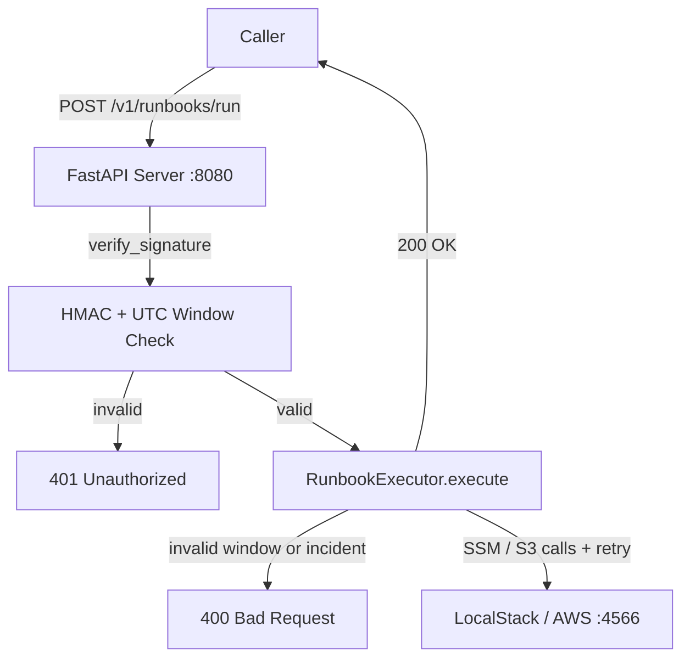
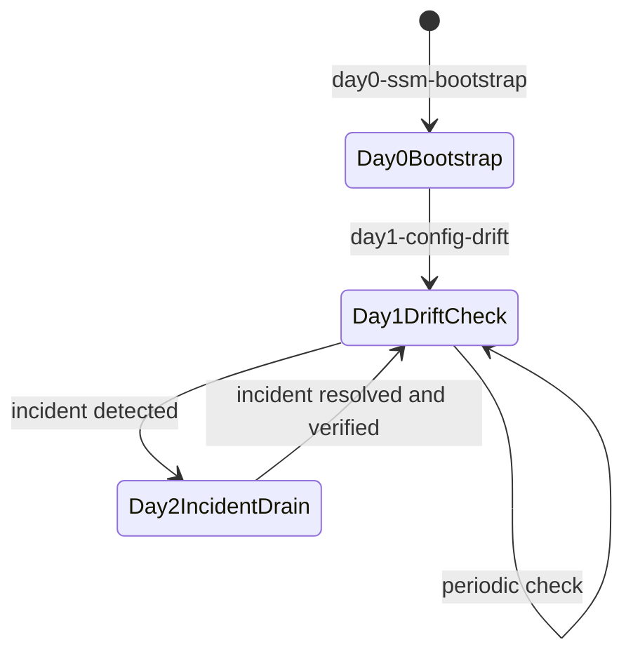

# Design Notes: Day-0 to Day-2 Runbook Runner

Runbooks are stored as JSON definitions under `runbooks/day0`, `runbooks/day1`, and `runbooks/day2`, executed by `RunbookExecutor` in `src/runbook_runner/engine.py`, and exposed over HTTP in `src/runbook_runner/server.py`.

## Execution Pipeline

## Runbook Stage Transitions

## Edge Cases and Limitations

Timestamps and UTC window checks use UTC so Daylight Saving Time transitions do not shift allowed hours. Day-2 runbooks require an `incident_id` of at least 4 characters unless a grace extension is active during off-window execution. Transient AWS errors (`ThrottlingException`, HTTP `429`/`502`/`503`/`504`) retry up to 4 times with backoff capped at `2.0s`.

Limitations: `load_runbooks` reads JSON files from disk on each request in `_executor()`, and SSM `get_parameters_by_path` is not paginated for large parameter trees.
